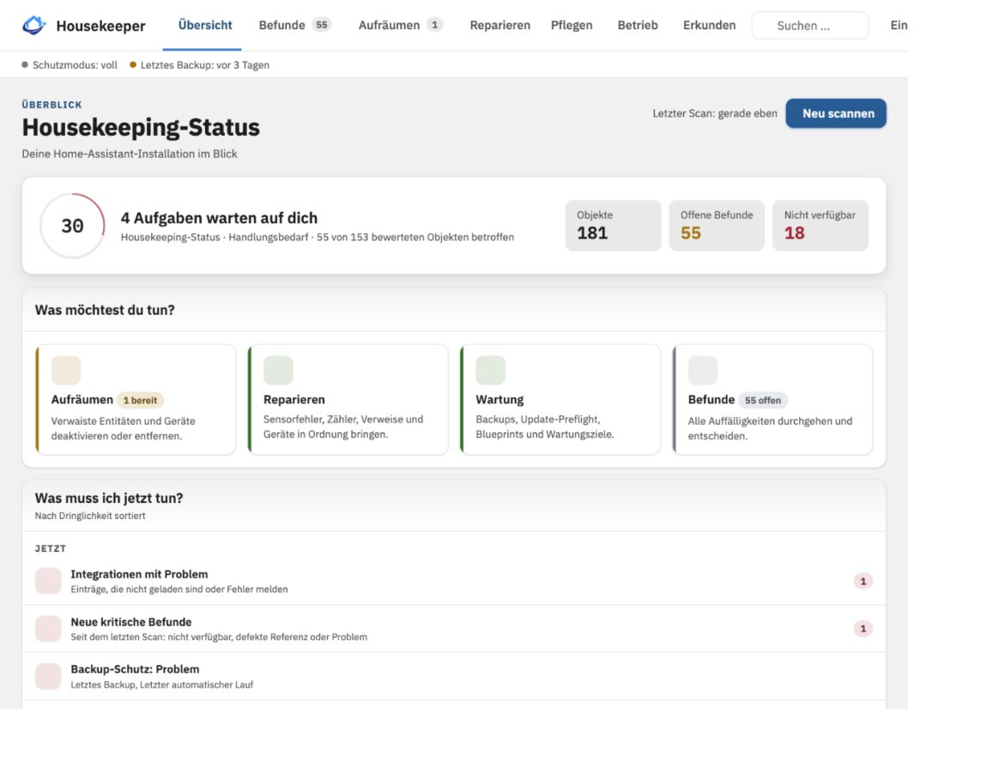
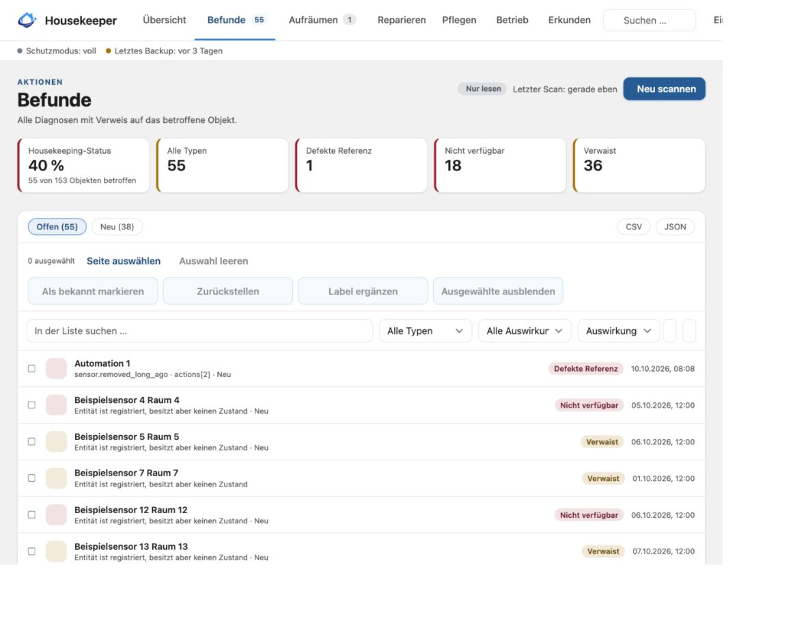
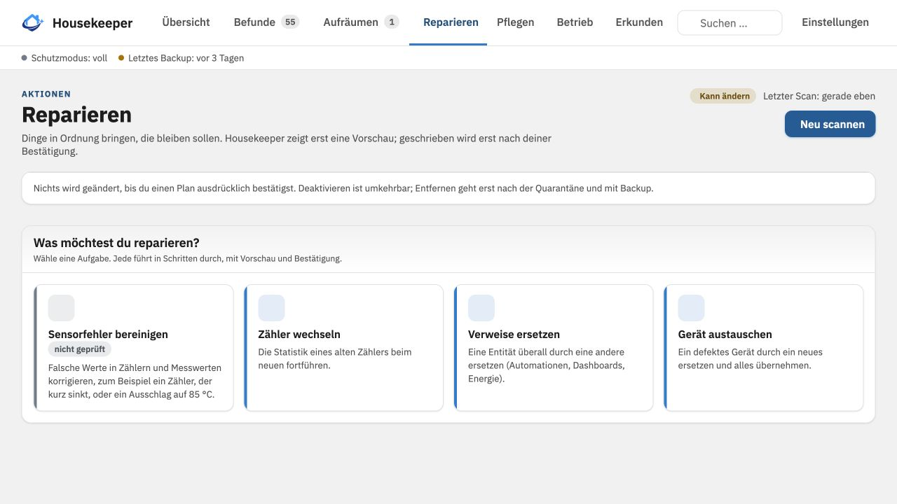
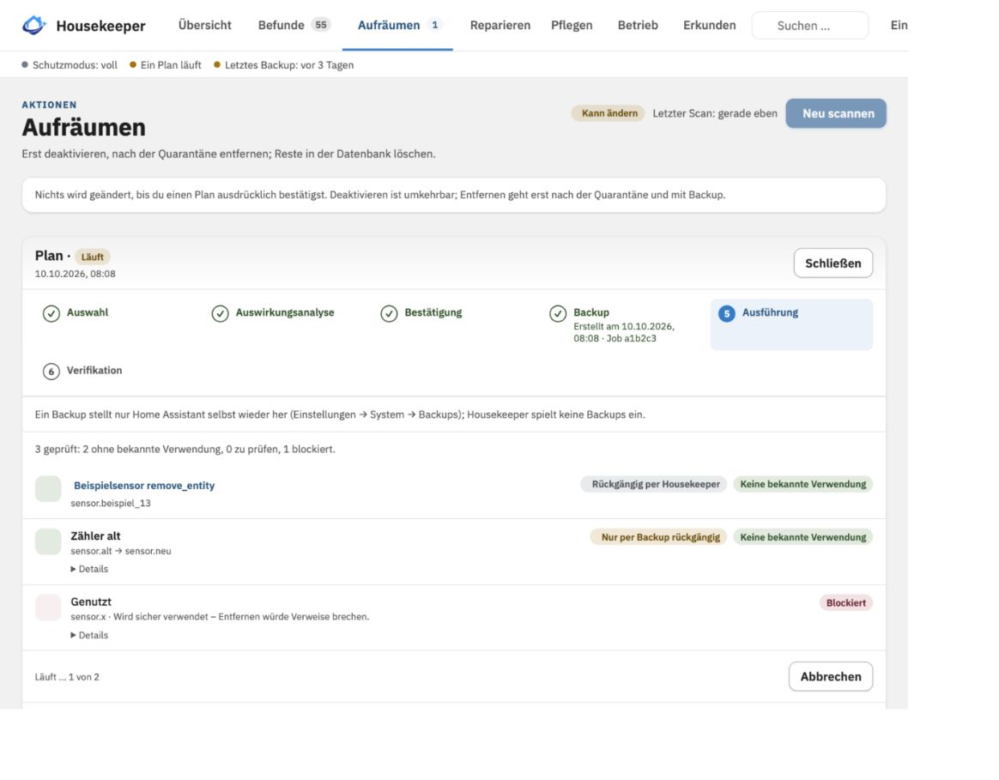
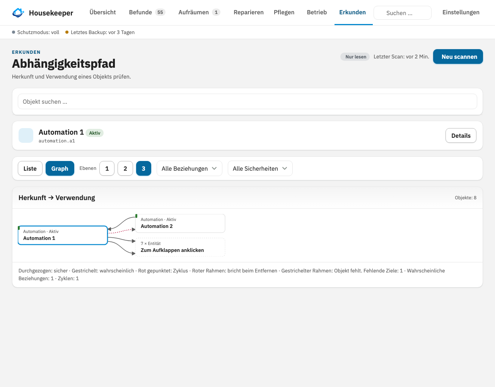
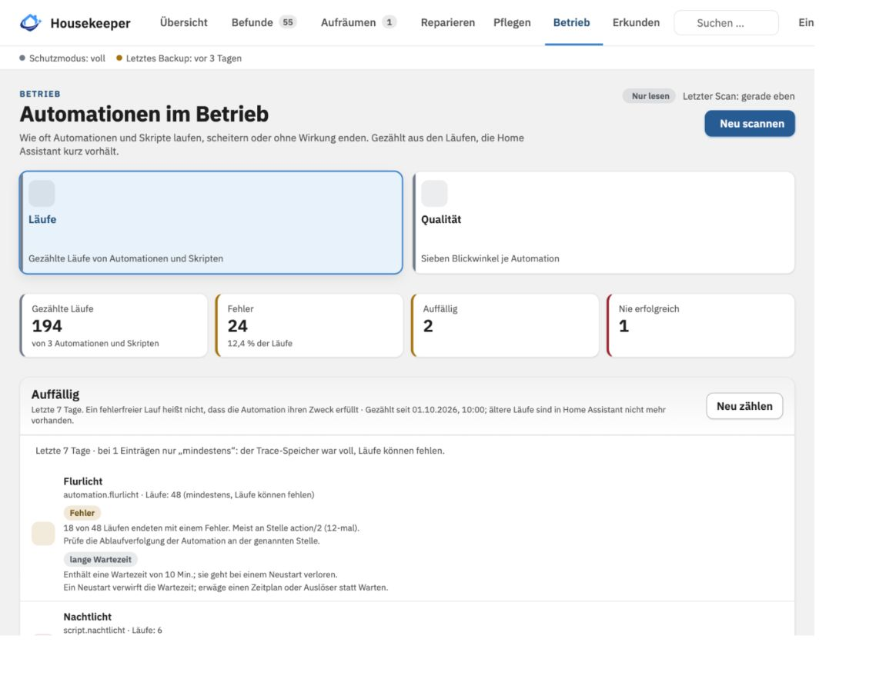
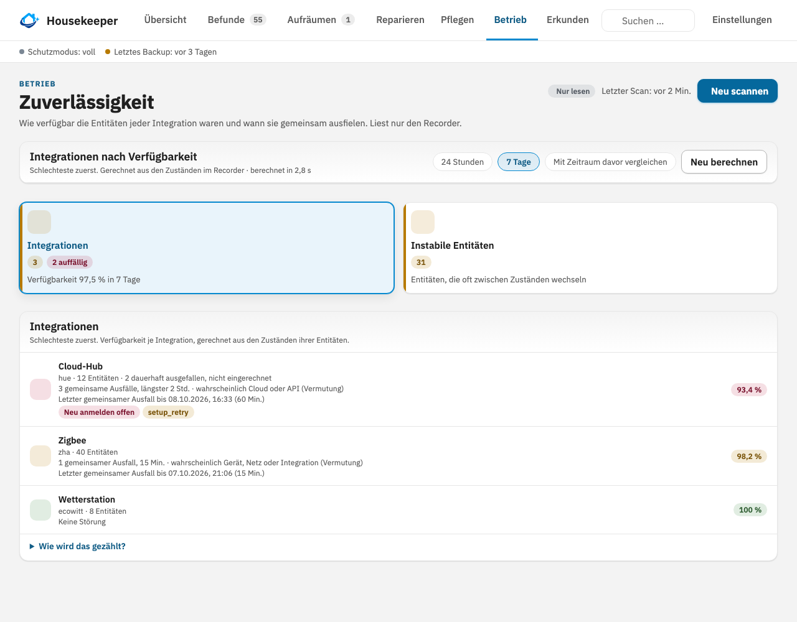

  

<h1 align="center">HA Housekeeper</h1>

  Wartung und Analyse für Home Assistant: Inventar, Diagnose und Abhängigkeiten auf einen Blick.

  
  
  
  
  

  
  
  

<em><a href="https://github.com/bertel2020/HA-Housekeeper/blob/main/README.md">English version</a></em>

HA Housekeeper ist eine Wartungs- und Analyseintegration für Home Assistant. Sie erstellt ein übersichtliches Inventar der Installation, erklärt verdächtige oder verwaiste Objekte und zeigt, wie Entitäten, Geräte, Integrationen, Bereiche und Automationen voneinander abhängen.

Das Ziel ist keine aggressive automatische Bereinigung. Housekeeper hilft zunächst zu verstehen, welche Objekte existieren, weshalb etwas als problematisch gilt und was eine Bereinigung oder Reparatur betreffen würde, bevor du sie bestätigst.

> Housekeeper liest und analysiert zunächst. Änderungen gibt es ausschließlich nach ausdrücklicher Bestätigung eines Plans. Pläne umfassen Quarantäne und Entfernen, Reparaturen, das Ersetzen von Verweisen, das Umbenennen von Entitäten, das Zuweisen von Bereichen, das Löschen ungenutzter Automationen, das Kürzen des Recorder-Verlaufs und weitere Wartungsaufgaben. Je nach Aktion verlangt Housekeeper eine Quarantänezeit, eine zusätzliche Bestätigung und ein erfolgreiches Backup. Umkehrbare Änderungen lassen sich zurücksetzen, solange ihre Ziele unverändert sind; endgültige Recorder- und Backup-Löschungen werden deutlich gekennzeichnet. Integrationen und Hubs werden nie verändert, und Housekeeper ändert nur, was ein bestätigter Plan nennt.

## Einblicke

  

| Befunde | Reparieren |
| --- | --- |
|  |  |

| Aufräumen | Abhängigkeitspfad |
| --- | --- |
|  |  |

| Automationen | Zuverlässigkeit |
| --- | --- |
|  |  |

## Warum HA Housekeeper?

In gewachsenen Home-Assistant-Installationen sammeln sich häufig Registry-Einträge, nicht verfügbare Entitäten, ausgetauschte Geräte, alte Statistiken und schwer nachvollziehbare Automationsreferenzen an. Ein fehlender Zustand allein erklärt nicht, ob eine Entität absichtlich deaktiviert wurde, ihre Integration deaktiviert ist oder das zugrunde liegende Gerät nicht mehr existiert.

Housekeeper verbindet Registry-Daten mit der laufenden Home-Assistant-Instanz und stellt diesen Zusammenhang in einem gemeinsamen, nur für Administratoren erreichbaren Panel dar.

## Highlights

- **Inventar und Diagnose**: Entitäten, Geräte, Integrationen, Bereiche und Automationen an einem Ort; jedes Objekt wird mit Begründung eingeordnet (aktiv, nicht verfügbar, deaktiviert, verwaist).
- **Befunde mit Auswirkung**: defekte Verweise, verwaiste und lange nicht verfügbare Entitäten, mögliche Duplikate, ungenutzte Automationen und schwache Batterien, geordnet danach, wie viel daran hängt.
- **Abhängigkeiten**: sehen, womit eine Entität, ein Gerät oder eine Automation zusammenhängt und was beim Entfernen kaputtginge.
- **Geführtes Aufräumen**: Vorschau, ausdrückliche Bestätigung, Backup, Prüfung und Rückgängig, Schritt für Schritt. Nichts läuft von allein.
- **Wartungsansichten**: Batterien, Zuverlässigkeit der Integrationen, Recorder-Last und Datenbank, Backup-Schutz, Automationsläufe und mehr.
- **Auto-Pause**: Eine Integration, die dauernd an der Einrichtung scheitert, wird pausiert und später wieder versucht (3 × 1 Std., 3 × 3 Std., 12 × 6 Std., dann täglich, höchstens 7 Tage), damit ein ausgefallener Dienst nicht tausendmal am Tag gefragt wird. Standardmäßig aus; du gibst jede Integration frei oder schickst eine von Hand hinein.
- **Hausfunktionen**: wichtige Funktionen des Hauses (Heizung, Alarm, Photovoltaik) aus eigenen Objekten zusammenstellen und im Blick behalten, mit Verlauf, Verfügbarkeit und Sensoren. Ein Vermerk wie „Absichtlich offline“ gilt auf Wunsch nur nachts oder zu festen Zeiten.
- **Ausnahmeregeln und Urlaubsmodus**: nimm Objekte nach Bereich, Label, Integration oder Typ aus, oder nur solange eine Urlaubs-Entität oder ein Kalender Abwesenheit meldet, damit erwartete Ausfälle ruhig bleiben.
- **KI-Zugriff**: Programme und KI-Agenten, die Home-Assistant-Dienste aufrufen können (zum Beispiel ha-mcp), lesen die Befunde und markieren sie auf Wunsch in Housekeepers eigener Merkliste, nie in Home Assistant. Standardmäßig aus, mit Grenzen, automatischem Ausschalten, einem Protokoll jedes Aufrufs und Zurücknehmen.
- **Änderungen seit dem letzten Scan**, Sensoren, Reparaturhinweise, ein Scan-Knopf und der Dienst `ha_housekeeper.scan` für eigene Dashboards und Automationen sowie die Beobachtung nach Updates: was nach einem Update oder Neustart nicht mehr läuft.

## Schnellstart

1. HA Housekeeper über den Button in HACS öffnen, herunterladen und Home Assistant neu starten. Ab Home Assistant 2026.11 ist HACS als **Marketplace** eingebaut; die Schritte sind dieselben.

   

2. **Integration hinzufügen** (nicht optional): **Einstellungen → Geräte & Dienste → Integration hinzufügen → HA Housekeeper** oder über den Button. Ohne diesen Schritt erscheint kein Menüpunkt.

   

3. Als Administrator **Housekeeper** in der Seitenleiste öffnen. Der erste Scan läuft automatisch; **Neu scannen** aktualisiert ihn.
4. Mit **Befunde** beginnen und einen Befund öffnen: Ursache und Abhängigkeiten stehen oben. Unter **Aufräumen** baust du einen Plan, der bis zu deiner Bestätigung nur eine Vorschau zeigt.

> Neue Installationen starten im Schutzmodus **nur lesen**. Damit Housekeeper etwas ändern darf, erhöhe ihn unter **Einstellungen → Schutzmodus**.

Mehr zur Installation (manuell, eigenes Repository), zu allen Ansichten und Einstellungen steht im **[Benutzerhandbuch](docs/USER-GUIDE.de.md)**.

## Sicherheit in Kürze

- Das Panel ist nur für Administratoren.
- Housekeeper liest und analysiert zuerst; jede Änderung ist ein von dir bestätigter Plan, mit Backup, wo die Aktion eines braucht.
- Integrationen und Hubs werden nie verändert, keine `.storage`-Datei wird direkt bearbeitet, und nichts wird automatisch bereinigt.

Details: [Sicherheitsmodell](docs/USER-GUIDE.de.md#sicherheitsmodell) und [Aktuelle Einschränkungen](docs/USER-GUIDE.de.md#aktuelle-einschränkungen).

## Änderungsprotokoll

Die Versionshinweise auf Deutsch und Englisch stehen in [CHANGELOG.md](CHANGELOG.md).

## Dank an die Contributors

Vielen Dank an [@jayjojayson](https://github.com/jayjojayson) für die Beiträge und das Feedback, die HA Housekeeper besser gemacht haben.

## Haftungsausschluss

HA Housekeeper ist ein privat entwickeltes, kostenloses Open-Source-Projekt und wird
ohne Gewährleistung oder Garantie bereitgestellt. Die Nutzung erfolgt auf eigene
Verantwortung; insbesondere kann keine Garantie für einen fehlerfreien Betrieb sowie
für die Richtigkeit, Vollständigkeit, Verfügbarkeit oder den dauerhaften Erhalt von
Konfiguration und Daten übernommen werden. **Housekeeper kann Einträge, Dateien und
Statistiken in deiner Home-Assistant-Installation ändern oder entfernen. Lege daher
vor jedem Aufräumen ein Home-Assistant-Backup an und erstelle regelmäßig unabhängige
Backups, auch außerhalb des Home-Assistant-Systems.**

## Lizenz

Dieses Projekt steht unter der [MIT-Lizenz](LICENSE).
Copyright 2026 Roberto / bertel2020.
