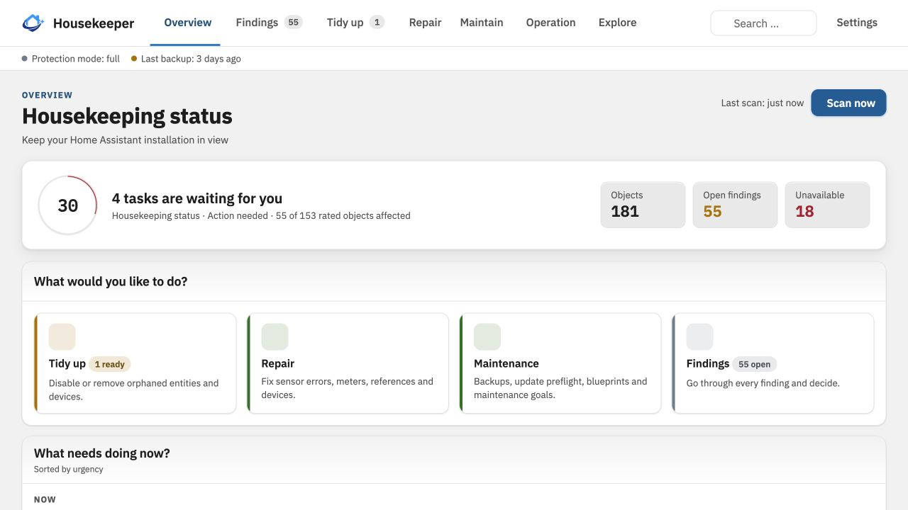
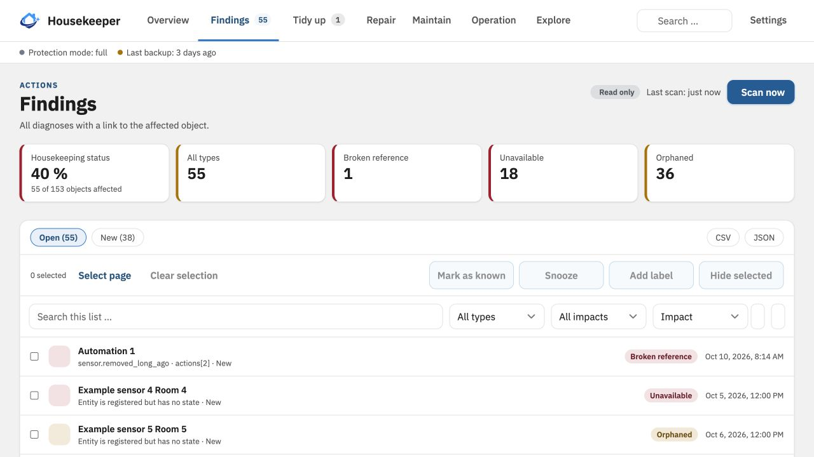
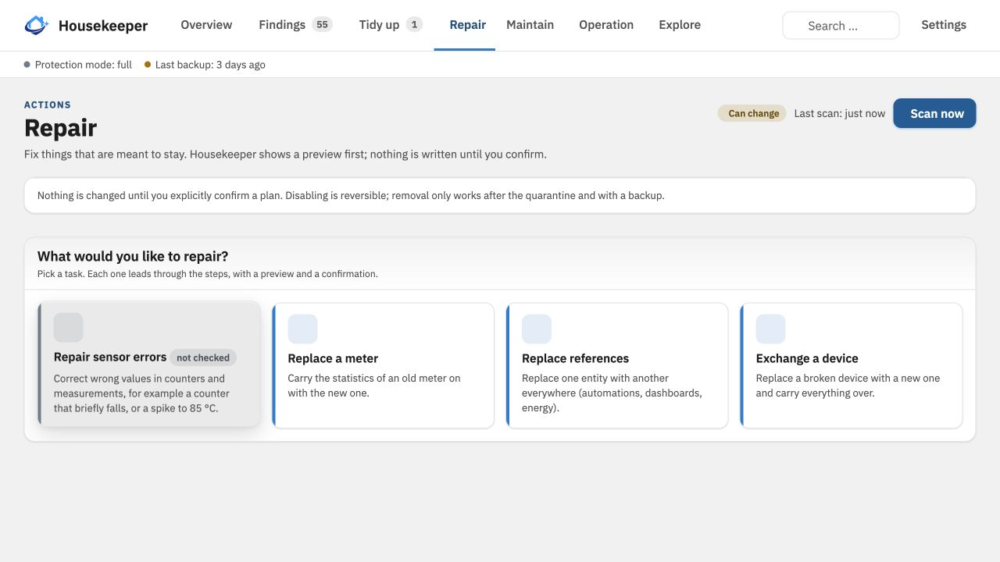
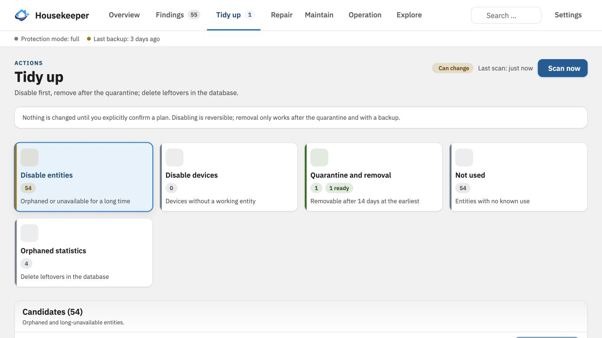
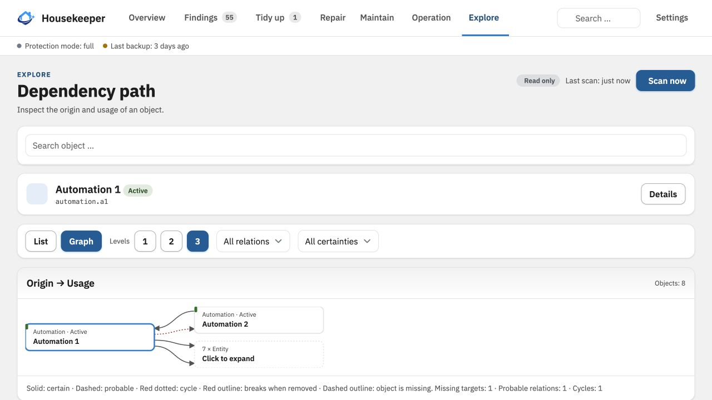
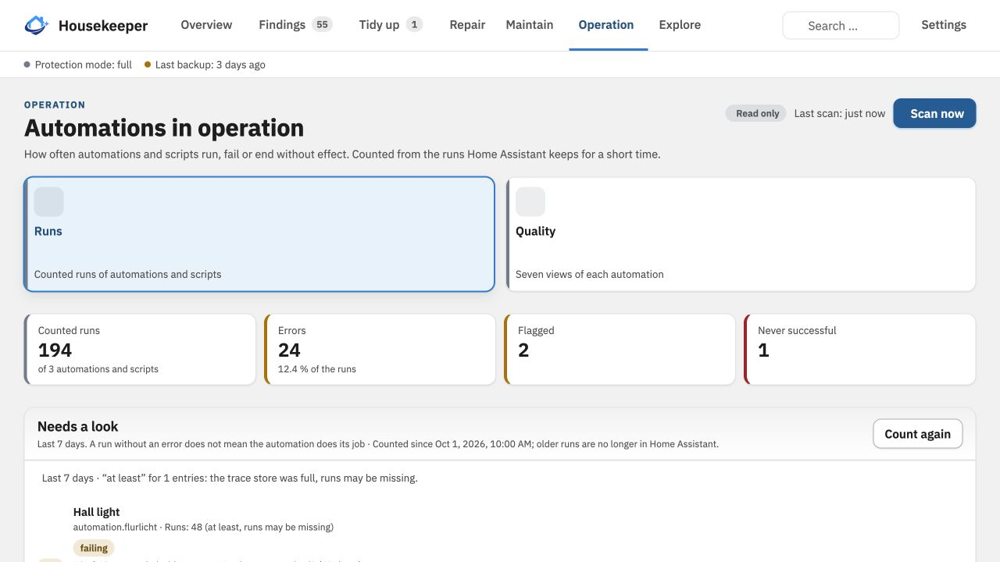
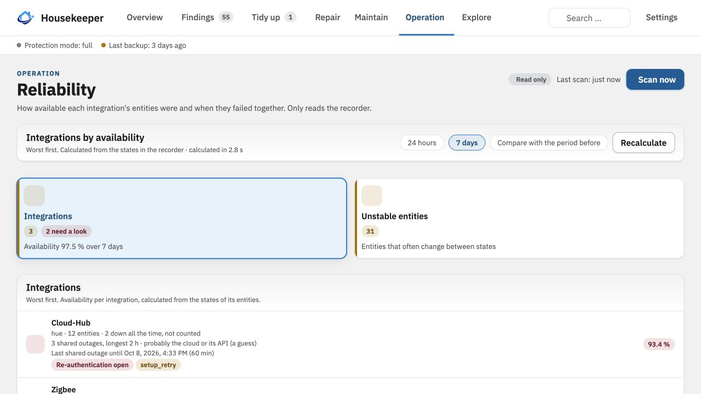

  

<h1 align="center">HA Housekeeper</h1>

  Maintenance and analysis for Home Assistant: inventory, diagnostics, and dependencies at a glance.

  
  
  
  
  

  
  
  

<em><a href="https://github.com/bertel2020/HA-Housekeeper/blob/main/README.de.md">Deutsche Version</a></em>

HA Housekeeper is a maintenance and analysis integration for Home Assistant. It creates a clear inventory of your installation, explains suspicious or orphaned objects, and shows how entities, devices, integrations, areas, and automations depend on each other.

The goal is not aggressive automatic cleanup. Housekeeper helps you understand what exists, why something is considered problematic, and what a cleanup or repair would affect before you confirm it.

> Housekeeper reads and analyzes first. It changes something only after you explicitly confirm a plan. Plans cover quarantine and removal, repairs, replacing references, renaming entities, assigning areas, deleting unused automations, trimming recorder history and other maintenance tasks. Depending on the action, Housekeeper requires a quarantine period, an additional confirmation and a successful backup. Reversible changes can be undone while their targets remain unchanged; irreversible recorder and backup deletions are clearly marked. Integrations and hubs are never modified, and Housekeeper changes only what a confirmed plan names.

## Screenshots

  

| Findings | Repair |
| --- | --- |
|  |  |

| Tidy up | Dependency path |
| --- | --- |
|  |  |

| Automations | Reliability |
| --- | --- |
|  |  |

## Why HA Housekeeper?

Mature Home Assistant installations often accumulate registry entries, unavailable entities, replaced devices, old statistics, and automation references that are difficult to assess safely. A missing state alone does not explain whether an entity was intentionally disabled, whether its integration is disabled, or whether the underlying device no longer exists.

Housekeeper combines registry data and the live Home Assistant runtime to provide that context in one administrator-only panel.

## Highlights

- **Inventory and diagnostics**: entities, devices, integrations, areas and automations in one place; every object is classified (active, unavailable, disabled, orphaned) with a reason.
- **Findings with impact**: broken references, orphaned and long-unavailable entities, possible duplicates, unused automations and low batteries, ranked by how much depends on them.
- **Dependencies**: see what an entity, device or automation is connected to, and what would break if you removed it.
- **Guided cleanup**: preview, explicit confirmation, backup, verification and undo, step by step. Nothing runs on its own.
- **Maintenance views**: batteries, reliability of integrations, recorder load and database, backup protection, automation runs and more.
- **Home functions**: put together important functions of your home (heating, alarm, photovoltaics) from your own objects and keep an eye on them, with history, availability and sensors. A mark such as “Offline on purpose” can apply only at night or at fixed times.
- **Exception rules and vacation mode**: leave out objects by area, label, integration or type, or only while a vacation entity or calendar says you are away, so that expected outages stay quiet.
- **AI access**: programs and AI agents that can call Home Assistant services (for example ha-mcp) read the findings and, if you allow it, mark them in Housekeeper's own list, never in Home Assistant. Off by default, with limits, an automatic switch-off, a log of every call and an undo.
- **Changes since the last scan**, sensors, repair hints, a scan button and the service `ha_housekeeper.scan` for your own dashboards and automations and a watch after updates: what stopped working after an update or restart.

## Quick start

1. Open HA Housekeeper in HACS with the button below, download it and restart Home Assistant. From Home Assistant 2026.11 HACS is built in as the **Marketplace**; the steps are the same there.

   

2. **Add the integration** (not optional): **Settings → Devices & services → Add integration → HA Housekeeper**, or use the button below. Without this step no sidebar entry appears.

   

3. Open **Housekeeper** in the sidebar as an administrator. The first scan runs automatically; **Scan now** refreshes it.
4. Start with **Findings** and open a finding to see the cause and what depends on it. Under **Clean up** you build a plan, which only shows a preview until you confirm it.

> New installs start in protection mode **read only**. To let Housekeeper change something, raise it under **Settings → Protection mode**.

More on installation (manual, custom repository), every view and all settings is in the **[User Guide](docs/USER-GUIDE.md)**.

## Safety in short

- The panel is for administrators only.
- Housekeeper reads and analyzes first; every change is a plan you confirm, with a backup where the action needs one.
- Integrations and hubs are never modified, no `.storage` file is edited directly, and nothing is cleaned up automatically.

Details: [Safety model](docs/USER-GUIDE.md#safety-model) and [Current limitations](docs/USER-GUIDE.md#current-limitations).

## Changelog

See [CHANGELOG.md](CHANGELOG.md) for release notes in English and German.

## Thanks to the contributors

Many thanks to [@jayjojayson](https://github.com/jayjojayson) for the contributions and feedback that helped improve HA Housekeeper.

## Disclaimer

HA Housekeeper is a privately developed, free open-source project and is provided
without warranty or guarantee. Use is at your own risk; in particular, no guarantee
can be given for error-free operation or for the correctness, completeness,
availability or lasting preservation of configuration and data. **Housekeeper can
change or remove entries, files and statistics in your Home Assistant installation.
Therefore make a Home Assistant backup before every cleanup and make independent
backups regularly, also outside the Home Assistant system.**

## License

This project is released under the [MIT License](LICENSE).
Copyright 2026 Roberto / bertel2020.
